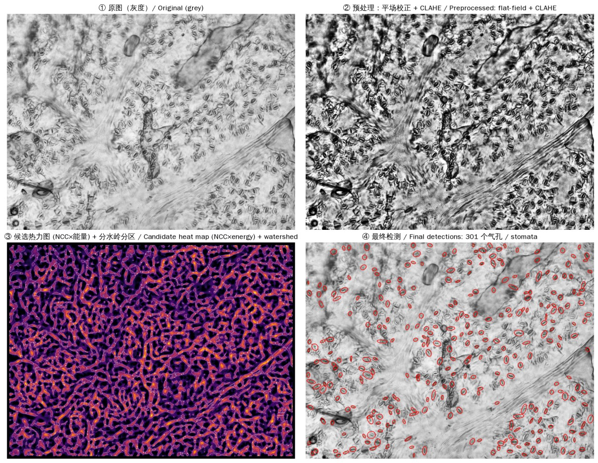

# 叶表皮显微图像气孔（Stomata）自动检测与计数 / Automatic Stomata Detection and Counting in Leaf-Epidermis Micrographs

**语言 / Language：** 中文（下文） · [English](#english-version)

面向高分辨率叶表皮透射显微图像的气孔检测、定位与计数工具，分两个阶段：

| 阶段 | 方法 | 依赖 | 适用 |
|---|---|---|---|
| **一：免训练基线** | 平场校正 + CLAHE + 自举模板旋转 NCC + DoH 斑点 + 分水岭 + 多维几何/结构硬过滤 | OpenCV / scikit-image / SciPy | 没有标注；快速估计；为深度模型生成预标注 |
| **二：生产级深度学习** | YOLOv8-P2（小目标检测头）+ SAHI 切片推理，点标注小样本微调 | + Ultralytics / SAHI（GPU） | 追求高精度，愿意投入少量人工校正 |



---

## 快速开始

```bash
pip install -r requirements.txt

# 单张图：CSV + 检测标注图 + 流水线四联图 + 与参考标注对比的 P/R/F1
python scripts/count_stomata.py data/samples/leaf_epidermis_01.jpg -o outputs --visualize \
       --eval data/annotations/leaf_epidermis_01_partial.json

# 20x 彩色 TIFF 系列：用测微尺图像自动标定 µm/px，气孔尺寸按物理长度给出
python scripts/count_stomata.py "data/samples/test0*.tif" -o outputs \
       --micrometer "data/samples/stage micrometer 20x objectivetif.tif" --stoma-size-um 28

# 已知像素尺寸时直接给出（导出 µm 与 气孔密度 /mm²）
python scripts/count_stomata.py "images/*.tif" -o outputs --um-per-px 0.50 --stoma-size-um 28
```

```python
import cv2
from stomata import StomataCounter, DetectorConfig, visualize_pipeline, calibrate_stage_micrometer

cal = calibrate_stage_micrometer(cv2.imread("data/samples/stage micrometer 20x objectivetif.tif"))
cfg = DetectorConfig(um_per_px=cal.um_per_px, expected_major_um=28, margin_exclusion=True)
counter = StomataCounter(cfg)
reports = counter.run("data/samples/test001.tif")          # 文件 / 目录 / 通配符
counter.export_csv(reports, "outputs/stomata.csv")          # 逐气孔明细 + 汇总
rep = reports[0]
print(rep.count, rep.rows()[:3])                            # 总数、坐标、长轴
visualize_pipeline(cv2.imread("data/samples/test001.tif"), rep.result, save_path="outputs/pipeline.png",
                   zoom=(300, 150, 750, 480))
```

输出文件：

| 文件 | 内容 |
|---|---|
| `stomata_detections.csv` | 每个气孔一行：`image, id, x, y, major_axis_px, minor_axis_px, angle_deg, score, major_source, major_axis_um, minor_axis_um` |
| `stomata_detections_summary.csv` | 每张图一行：总数、密度 (/mm²)、长轴均值/标准差/中位数、候选数、边缘剔除数 |
| `*_detections.jpg` | 检测椭圆叠加图 |
| `*_pipeline.png` | 原图 / 预处理增强 / 候选热力图+分水岭 / 最终检测 四联图（`visualize_pipeline()`） |
| `*_points.json` | 点标注格式的检测结果，可直接作为人工校正的预标注 |

**唯一必须设置的参数是气孔大小**：`--expected-major`（像素，默认 34）或 `--stoma-size-um` + 标定。
仓库中三类样例图的大致取值：`leaf_epidermis_01.jpg` ≈ 34 px，`1.1.jpg` 等灰度 JPG ≈ 40 px，
20x 彩色 TIFF ≈ 56 px（≈ 28 µm @ 0.50 µm/px）。

---

## 阶段一：免训练流水线

代码：`stomata/preprocessing.py`、`stomata/templates.py`、`stomata/detector.py`

### 1. 预处理增强
透射图像可写成 `I = L·R + n`（L 为叶脉阴影/照明，R 为组织透过率）。
* **平场校正**：`I / (G_σ=40 * I)`，把乘性阴影变成常数。这也是不能用全局阈值 / Otsu 的原因：
  同一种气孔在亮区和叶脉暗区的灰度相差很大。
* **CLAHE**（16×16 分块）均衡局部对比度；**DoG** 带通（σ=1/10）供可视化与扩展使用。
* **黑顶帽 (black-hat)**：`closing(I) − I` 提取宽度 < 9 px 的暗线（保卫细胞壁、裂隙、表皮细胞壁），
  其局部密度作为"暗结构能量"。

### 2. 候选定位与分割
* **自举模板（完全无监督）**：先用合成椭圆环模板在暗结构图上找 60 个最可信的气孔，按二阶矩方向对齐、
  平均并做 4 重对称化，得到数据驱动模板；再按最佳匹配角度对齐迭代一次。模板可以保存
  （`--save-template`），供整批图像复用。
* **旋转 × 尺度 × 长宽比 NCC**：18 个角度 × 3 个尺度 × 2 种长宽比。NCC 对局部亮度/对比度不变，只对结构形状敏感；
  结果再乘以暗结构能量门控，压制空白背景上的噪声相关。
* **多尺度 Hessian 斑点 (DoH)**：在反相平场图上计算 `σ⁴(LxxLyy − Lxy²)`，σ ≈ 长轴/4.5 ~ 长轴/3。
  气孔整体是"暗椭圆斑"，两个主曲率同号且相近；细胞壁、叶脉是线状，det ≈ 0，被压制。
  DoH 可以作为候选图（`candidate_mode="doh"`），默认作为验证特征使用。
* **大图分块**：按 2048 px 分块、96 px 重叠计算响应图，**只写回核心区，拼接成整图响应图后再统一找峰**，
  所以分块边界上的气孔不会被计两次（`tests/test_detector.py::test_tiled_response_equals_full` 验证拼接结果与整图计算逐像素一致）。
* **局部极大值 → 自适应阈值掩膜 → 距离变换 + 标记控制分水岭**，分离粘连的气孔；每个候选再在 ±4 px、±5°、
  更细的尺度/长宽比上精修。

### 3. 几何与结构先验硬过滤（阈值均在 `DetectorConfig` 中可配置）

| 判据（默认阈值） | 物理含义 | 主要剔除 |
|---|---|---|
| NCC 得分 ≥ 0.30 | 与气孔模板的形状相似度 | 噪声 |
| **DoH 斑点强度** ≥ 0.15 | 候选处是否为"暗椭圆斑" | **细胞壁交界点、单条弧线** |
| **轴向延续比** ≤ 0.85 | 沿长轴 ±0.8L 处响应 / 中心响应。气孔有"端点"，叶脉条纹沿长轴延伸（≈1） | **叶脉、平行纤维** |
| **结构张量相干度** ≤ 0.70 | σ=16 邻域内方向一致性；平行纹理 → 1 | 叶脉、纤维束 |
| 内部暗度 ≤ −0.10 | 椭圆内 − 外环的平均灰度 | 空白区、亮斑 |
| 区域面积比 / 偏心率 ≤ 0.99 / solidity ≥ 0.3 / 惯性比 | 分水岭区域形状（区域过小时跳过） | 退化的线状响应 |
| 射线闭合度 / 椭圆拟合残差（默认只用于测量） | 32 条射线上"亮保卫细胞 → 暗外壁 → 外侧回升"，谷点最小二乘拟合椭圆 | 可选：`min_ray_coverage`、`require_ellipse_fit=True` |

射线椭圆拟合给出**长轴直径测量值**（`major_source = ellipse`）；拟合失败时回退为模板尺度估计（`template`）。
最后做中心距离 NMS（中心距 < 0.75 × 短轴视为同一气孔）。

### 4. 边缘剔除（Margin Exclusion）
`margin_exclusion=True`（默认）时剔除不完整的边缘气孔，两种规则：
* `margin_mode="bbox"`：旋转椭圆的外接框越出图像（或 `margin_px` 安全边距）即剔除；
* `margin_mode="center"`：中心距边界 < `margin_px`（默认 0.5 × 长轴）即剔除。

### 5. 物理尺度标定
`stomata/calibration.py::calibrate_stage_micrometer()`：对测微尺图像的刻线剖面做自相关求周期初值，
逐条定位刻线（亚像素），迭代剔除离群刻线后线性拟合得到周期。样例
`stage micrometer 20x objectivetif.tif` 的结果是 **19.90 px/格 → 0.503 µm/px**（61 条刻线，残差 0.47 px，
按每格 10 µm 计算；如果你的测微尺刻度不同，请用 `--division-um` 指定）。

### 6. 评估接口
`stomata/evaluation.py`：`match_points()` 用匈牙利算法做一对一点匹配（距离 ≤ tol），
**重复检测计为 FP**，支持 `ignore` 点；`evaluate_against_annotation()` 支持"只标注若干矩形区域"的部分标注。
CLI 的默认容差为 0.35 × 期望长轴。

---

## 结果（请如实看待）

参考标注在 `data/annotations/`，是人工目视核验的**局部矩形区域**，覆盖三种成像风格，共 41 个气孔：

| 图像 | 风格 | 期望长轴 | 全图计数 | 参考区域 P | R | F1 | 单图耗时* |
|---|---|---|---|---|---|---|---|
| `leaf_epidermis_01.jpg` | 灰度，2000×1500 | 34 px | 301 | 0.81 | 0.74 | 0.77 | ~21 s |
| `1.1.jpg` | 高对比灰度，2560×1920 | 40 px | 212 | 0.56 | 0.63 | 0.59 | ~39 s |
| `test001.tif` | 20x 彩色，1360×1024 | 56 px | 53 | 1.00 | 0.70 | 0.82 | ~8 s |

\* 在本开发容器的 CPU 上测得。

需要注意：
* **参考集很小，而且默认阈值就是在这三组区域上联合标定的**，上表更接近"训练集表现"，不是无偏估计。
* **对整幅图的目视检查表明，全图召回率明显低于上表**：在 `1.1.jpg` 和 `test001.tif` 上，大约只有一半的明显气孔被检出。
  主要漏检是失焦的、开放度很大的、以及与周围暗结构粘连的气孔；主要误检是细胞壁围成的类椭圆小室和叶脉边缘。
* 不同成像风格之间差异很大，每一批图像都需要至少设对气孔尺寸，最好再用少量标注核对一次阈值。
* 在带光照不均、随机细胞壁和叶脉条纹的**合成图**上（`tests/synthetic.py`）P = R = 1.0，
  说明算法逻辑本身正确，真实图的难点在于成像。

**结论**：阶段一适合在没有标注时做快速估计，以及作为阶段二的**预标注工具**。
要做可发表的定量统计，请按下文用少量人工校正数据微调深度模型，并在独立标注的整图上评估。

---

## 已训练模型

| 权重 | 训练数据 | 验证集（人工标注，57 张整图） |
|---|---|---|
| `models/stomata_yolov8n_p2_human_v2/best.pt`（**推荐**，conf 0.40） | Stomata_Enhanced 人工标注 232 张 | P 0.937 / R 0.945 / F1 0.941，计数误差 6.6% |
| `models/stomata_yolov8n_p2_human_v3_defocus/best.pt`（存档） | 同上 + 离焦模糊增强 | P 0.928 / R 0.947 / F1 0.937，计数误差 7.5%；模糊与小气孔召回更高，见 `docs/DEFOCUS_AUGMENT.md` |
| `models/stomata_yolov8n_p2_human/best.pt`（conf 0.45） | Stomata_Enhanced 人工标注 126 张 | P 0.935 / R 0.944 / F1 0.939，计数误差 6.8%；在 106 张独立新图上 F1 0.939、计数误差 7.3% |
| `models/stomata_yolov8n_p2/best.pt` | 外部自动计数流程的伪标签 16 张 | P 0.921 / R 0.900 / F1 0.911，计数误差 8.9% |

表中数字按原 57 张计算。验证集中重复的 `23.2_1` 已删除，去重后的 56 张上 v2 为 P 0.937 / R 0.948 / F1 0.942，计数误差 6.4%，排名不变（见 [`data/samples/pre-trainning/TRAINING_REPORT.md`](data/samples/pre-trainning/TRAINING_REPORT.md) 第 3 节）。

数据结构、标注问题、收敛曲线与误差分析见 [`docs/TRAINING_REPORT.md`](docs/TRAINING_REPORT.md)。

**拍新图前请先看 [`docs/IMAGING_GUIDE.md`](docs/IMAGING_GUIDE.md)**：放大倍率、对焦、照明和图像处理要与训练图一致。拍完用 `python scripts/capture_qc.py 新图文件夹/` 检查，不合格的当场重拍。

## 阶段二：生产级深度学习方案

详见 [`docs/DEEP_LEARNING.md`](docs/DEEP_LEARNING.md) 与 [`docs/ANNOTATION_GUIDE.md`](docs/ANNOTATION_GUIDE.md)。概要：

* **架构选择**：**YOLOv8s-P2**（增加 stride-4 的 P2 检测头）。任务需要逐个坐标 + 长轴，检测模型能直接给出；
  气孔密度中等、边界可分，不需要 CSRNet/FIDTM 这类只擅长总数的密度估计。需要回归朝向时可换 YOLOv8-OBB。
* **禁止整图缩放**：训练时在原始分辨率上切 640×640（重叠 20%）的小块，推理同样切片，结果平移回全图后去重。
  默认使用内置的 `SlicedPredictor`：按"中心归属"去重，即每个目标只由其中心所在切片的核心区负责。
  也可以改用官方 SAHI（IoS + GREEDYNMM 合并，`--sahi`）。两者的对照实验见 `docs/SAHI_COMPARISON.md`：
  SAHI 的 F1 没有提升（0.9405 对 0.9410），且慢约 10%。
* **小样本流程**：阶段一预标注 → 人工在点标注工具里增删 → 点转框 →
  冻结 backbone 微调（`freeze=10`，`degrees=180` 旋转增强）→ 用阶段二模型再预标注下一批（主动学习）。

```bash
python scripts/dl_pipeline.py prelabel images/ -o labels_points/          # 1. 预标注
#   ……人工校正 labels_points/*.json ……
python scripts/dl_pipeline.py build labels_points/ --images images/ -o datasets/stomata   # 2. 切片数据集
python scripts/dl_pipeline.py train datasets/stomata/data.yaml --epochs 150            # 3. 微调（GPU）
python scripts/dl_pipeline.py predict images/ --weights runs/stomata/yolov8s_p2/weights/best.pt -o outputs_dl  # 4. 切片推理（默认 SlicedPredictor）
```

> 阶段二的训练和推理已在本仓库实际运行：CPU 训练，SAHI 0.12.8 / Ultralytics 8.4。结果见上方模型表和 `docs/`；
> 数据集构建和内置切片推理/去重有单元测试。

---

## 目录结构

```
stomata/
  preprocessing.py   平场校正、CLAHE、DoG、黑顶帽、Hessian 斑点图
  templates.py       合成模板、自举数据模板、旋转/尺度/长宽比模板库
  detector.py        ClassicalStomataDetector 与 DetectorConfig（阶段一核心）
  counter.py         StomataCounter：批量读取、计数、CSV 导出
  visualize.py       visualize_pipeline()、draw_detections()
  evaluation.py      Precision / Recall / F1、点匹配、部分区域标注评估
  calibration.py     测微尺 µm/px 标定
  quality.py         拍摄质量指标与质检阈值（清晰度、对比度、对焦均匀性）
  dl/                阶段二：数据集切片、YOLOv8-P2 训练、SAHI/内置切片推理
scripts/
  count_stomata.py   阶段一命令行
  dl_pipeline.py     阶段二命令行（prelabel / build / train / predict）
  capture_qc.py      拍摄后质检
data/samples/        样例图像（含测微尺图像）
data/annotations/    部分区域点标注（参考集）
tests/               单元测试 + 合成图端到端测试（pytest）
```

## 调参建议

| 现象 | 调整 |
|---|---|
| 放大倍率不同 | 先设对 `expected_major_px`（或 `--stoma-size-um` + 标定），它决定自举、尺度搜索和种子间距 |
| 漏检多 | 降低 `min_blob`（0.10）、`min_score`（0.25），放宽 `max_end_ratio`（0.9） |
| 叶脉上误检多 | 降低 `max_end_ratio`（0.75）或 `max_coherence`（0.6） |
| 细胞壁误检多 | 提高 `min_blob`（0.25），或设 `min_ray_coverage=0.25` / `require_ellipse_fit=True` |
| 很开放的气孔漏检 | `aspects=(1.0, 1.35, 1.7)`，`refine_aspects` 增加 1.8 |
| 整批同条件拍摄 | `--share-template` 或 `--save-template` / `--template` 复用模板，结果更一致 |

调阈值时请用 `--eval` 在自己的标注区域上核对，不要只凭一张图目测。

运行测试：`python -m pytest -q`

---

# English version

A tool for detecting, locating and counting stomata in high-resolution transmitted-light micrographs of leaf epidermis. It has two stages:

| Stage | Method | Dependencies | Use when |
|---|---|---|---|
| **1: training-free baseline** | flat-field correction + CLAHE + rotated NCC with a self-bootstrapped template + DoH blobs + watershed + multi-criteria geometric/structural hard filters | OpenCV / scikit-image / SciPy | no labels; quick estimates; pre-labels for the deep model |
| **2: production deep learning** | YOLOv8-P2 (small-object head) + sliced inference, few-shot fine-tuning from point labels | + Ultralytics / SAHI (GPU) | high accuracy, with some manual correction |


---

## Quick start

```bash
pip install -r requirements.txt

# single image: CSV + annotated image + four-panel pipeline figure + P/R/F1 against reference labels
python scripts/count_stomata.py data/samples/leaf_epidermis_01.jpg -o outputs --visualize \
       --eval data/annotations/leaf_epidermis_01_partial.json

# 20x colour TIFF series: calibrate µm/px from the micrometer image and give stoma size in µm
python scripts/count_stomata.py "data/samples/test0*.tif" -o outputs \
       --micrometer "data/samples/stage micrometer 20x objectivetif.tif" --stoma-size-um 28

# known pixel size (exports µm and stomatal density /mm²)
python scripts/count_stomata.py "images/*.tif" -o outputs --um-per-px 0.50 --stoma-size-um 28
```

```python
import cv2
from stomata import StomataCounter, DetectorConfig, visualize_pipeline, calibrate_stage_micrometer

cal = calibrate_stage_micrometer(cv2.imread("data/samples/stage micrometer 20x objectivetif.tif"))
cfg = DetectorConfig(um_per_px=cal.um_per_px, expected_major_um=28, margin_exclusion=True)
counter = StomataCounter(cfg)
reports = counter.run("data/samples/test001.tif")          # file / directory / glob
counter.export_csv(reports, "outputs/stomata.csv")          # per-stoma detail + summary
rep = reports[0]
print(rep.count, rep.rows()[:3])                            # count, coordinates, major axis
visualize_pipeline(cv2.imread("data/samples/test001.tif"), rep.result, save_path="outputs/pipeline.png",
                   zoom=(300, 150, 750, 480))
```

Output files:

| File | Content |
|---|---|
| `stomata_detections.csv` | one row per stoma: `image, id, x, y, major_axis_px, minor_axis_px, angle_deg, score, major_source, major_axis_um, minor_axis_um` |
| `stomata_detections_summary.csv` | one row per image: count, density (/mm²), mean/SD/median major axis, candidate count, border exclusions |
| `*_detections.jpg` | detection ellipses overlaid on the image |
| `*_pipeline.png` | four panels: original / preprocessed / candidate heat map + watershed / final detections (`visualize_pipeline()`) |
| `*_points.json` | detections as point labels, usable directly as pre-labels for manual correction |

**The only parameter you must set is the stoma size**: `--expected-major` (pixels, default 34) or `--stoma-size-um` plus calibration.
Approximate values for the three sample styles: `leaf_epidermis_01.jpg` ≈ 34 px, grey JPGs such as `1.1.jpg` ≈ 40 px,
20x colour TIFF ≈ 56 px (≈ 28 µm at 0.50 µm/px).

---

## Stage 1: training-free pipeline

Code: `stomata/preprocessing.py`, `stomata/templates.py`, `stomata/detector.py`

### 1. Preprocessing
A transmitted-light image can be written as `I = L·R + n` (L = vein shading / illumination, R = tissue transmittance).
* **Flat-field correction**: `I / (G_σ=40 * I)` turns multiplicative shading into a constant. This is also why a global
  threshold / Otsu cannot work: the same kind of stoma has very different grey levels in bright areas and in dark vein areas.
* **CLAHE** (16×16 tiles) evens out local contrast; a **DoG** band-pass (σ = 1/10) is kept for visualisation and extensions.
* **Black-hat**: `closing(I) − I` extracts dark lines narrower than 9 px (guard-cell walls, slits, epidermal cell walls);
  their local density is the "dark-structure energy".

### 2. Candidate localisation and segmentation
* **Self-bootstrapped template (fully unsupervised)**: a synthetic elliptical-ring template first finds the 60 most
  confident stomata on the dark-structure map; they are aligned by second-moment orientation, averaged and 4-fold
  symmetrised into a data-driven template, then aligned by best matching angle for one more iteration. The template can
  be saved (`--save-template`) and reused for a whole batch.
* **Rotation × scale × aspect NCC**: 18 angles × 3 scales × 2 aspect ratios. NCC is invariant to local brightness/contrast
  and responds only to structural shape; the result is multiplied by a dark-structure energy gate to suppress noise
  correlation on blank background.
* **Multi-scale Hessian blobs (DoH)**: `σ⁴(LxxLyy − Lxy²)` on the inverted flat-field image, σ ≈ major/4.5 – major/3.
  A stoma is a dark elliptical blob with two principal curvatures of the same sign and similar size; cell walls and veins
  are line-like (det ≈ 0) and are suppressed. DoH can serve as the candidate map (`candidate_mode="doh"`) and is used as
  a verification feature by default.
* **Tiling large images**: the response map is computed in 2048 px tiles with 96 px overlap, **only the core of each tile
  is written back, and peaks are found once on the stitched map**, so stomata on tile borders are never counted twice
  (`tests/test_detector.py::test_tiled_response_equals_full` checks that the stitched map equals the whole-image map pixel by pixel).
* **Local maxima → adaptive-threshold mask → distance transform + marker-controlled watershed** separate touching stomata;
  each candidate is then refined within ±4 px, ±5° and finer scales/aspects.

### 3. Geometric and structural hard filters (all thresholds configurable in `DetectorConfig`)

| Criterion (default) | Physical meaning | Mainly rejects |
|---|---|---|
| NCC score ≥ 0.30 | shape similarity to the stoma template | noise |
| **DoH blob strength** ≥ 0.15 | is the candidate a dark elliptical blob? | **cell-wall junctions, single arcs** |
| **Axial end ratio** ≤ 0.85 | response at ±0.8L along the major axis / centre response. A stoma has ends; vein stripes continue along the axis (≈ 1) | **veins, parallel fibres** |
| **Structure-tensor coherence** ≤ 0.70 | orientation consistency in a σ = 16 neighbourhood; parallel texture → 1 | veins, fibre bundles |
| Interior darkness ≤ −0.10 | mean grey inside the ellipse − outer ring | blank areas, bright spots |
| Area ratio / eccentricity ≤ 0.99 / solidity ≥ 0.3 / inertia ratio | shape of the watershed region (skipped for tiny regions) | degenerate line-like responses |
| Ray closure / ellipse-fit residual (measurement only by default) | on 32 rays, "bright guard cell → dark outer wall → rising outside"; least-squares ellipse through the valley points | optional: `min_ray_coverage`, `require_ellipse_fit=True` |

The ray ellipse fit gives the **measured major-axis diameter** (`major_source = ellipse`); if the fit fails, the template-scale
estimate is used (`template`). A final centre-distance NMS treats centres closer than 0.75 × minor axis as the same stoma.

### 4. Margin exclusion
With `margin_exclusion=True` (default), incomplete stomata at the image border are removed, using one of two rules:
* `margin_mode="bbox"`: reject if the bounding box of the rotated ellipse leaves the image (or the `margin_px` safety margin);
* `margin_mode="center"`: reject if the centre is closer than `margin_px` (default 0.5 × major axis) to the border.

### 5. Physical scale calibration
`stomata/calibration.py::calibrate_stage_micrometer()`: autocorrelation of the tick profile of a micrometer image gives an
initial period; each tick is located (sub-pixel), outlier ticks are removed iteratively and a linear fit gives the period. For
the sample `stage micrometer 20x objectivetif.tif` the result is **19.90 px/division → 0.503 µm/px** (61 ticks, residual 0.47 px,
assuming 10 µm per division; use `--division-um` if your micrometer differs).

### 6. Evaluation interface
`stomata/evaluation.py`: `match_points()` performs one-to-one Hungarian point matching (distance ≤ tol);
**duplicate detections count as FP** and `ignore` points are supported. `evaluate_against_annotation()` supports partial
annotations that label only some rectangles. The CLI default tolerance is 0.35 × expected major axis.

---

## Results (please read critically)

Reference labels are in `data/annotations/`: manually verified **local rectangles** covering three imaging styles, 41 stomata in total:

| Image | Style | Expected major | Whole-image count | Reference-region P | R | F1 | Time per image* |
|---|---|---|---|---|---|---|---|
| `leaf_epidermis_01.jpg` | grey, 2000×1500 | 34 px | 301 | 0.81 | 0.74 | 0.77 | ~21 s |
| `1.1.jpg` | high-contrast grey, 2560×1920 | 40 px | 212 | 0.56 | 0.63 | 0.59 | ~39 s |
| `test001.tif` | 20x colour, 1360×1024 | 56 px | 53 | 1.00 | 0.70 | 0.82 | ~8 s |

\* measured on the CPU of this development container.

Caveats:
* **The reference set is tiny and the default thresholds were calibrated jointly on these three regions**, so the table is
  closer to training-set performance than to an unbiased estimate.
* **Visual inspection of whole images shows much lower recall than the table**: on `1.1.jpg` and `test001.tif` only about half of
  the obvious stomata are found. Misses are mostly defocused, widely open or stomata merged with surrounding dark structures;
  false positives are mostly ellipse-like cells enclosed by cell walls and vein edges.
* Imaging styles differ a lot: for each batch at least set the stoma size correctly, and ideally check the thresholds on a few labels.
* On **synthetic images** with uneven illumination, random cell walls and vein stripes (`tests/synthetic.py`) P = R = 1.0,
  so the algorithm logic is correct; the difficulty in real images comes from imaging.

**Conclusion**: stage 1 is suitable for quick estimates without labels and as a **pre-labelling tool** for stage 2.
For publishable quantitative results, fine-tune the deep model on a small amount of manually corrected data as described
below and evaluate on independently labelled whole images.

---

## Trained models

| Weights | Training data | Validation (human labels, 57 whole images) |
|---|---|---|
| `models/stomata_yolov8n_p2_human_v2/best.pt` (**recommended**, conf 0.40) | 232 human-labelled Stomata_Enhanced images | P 0.937 / R 0.945 / F1 0.941, count error 6.6% |
| `models/stomata_yolov8n_p2_human_v3_defocus/best.pt` (archived) | same + defocus blur augmentation | P 0.928 / R 0.947 / F1 0.937, count error 7.5%; higher recall for blurred and small stomata, see `docs/DEFOCUS_AUGMENT.md` |
| `models/stomata_yolov8n_p2_human/best.pt` (conf 0.45) | 126 human-labelled Stomata_Enhanced images | P 0.935 / R 0.944 / F1 0.939, count error 6.8%; on 106 independent new images F1 0.939, count error 7.3% |
| `models/stomata_yolov8n_p2/best.pt` | pseudo-labels from an external automatic pipeline, 16 images | P 0.921 / R 0.900 / F1 0.911, count error 8.9% |

The table uses the original 57 images. The duplicate `23.2_1` has since been removed from the validation set; on the 56 deduplicated images v2 scores P 0.937 / R 0.948 / F1 0.942 with count error 6.4%, and the ranking is unchanged (see section 3 of [`data/samples/pre-trainning/TRAINING_REPORT.md`](data/samples/pre-trainning/TRAINING_REPORT.md)).

Data structure, label issues, convergence curves and error analysis: [`docs/TRAINING_REPORT.md`](docs/TRAINING_REPORT.md).

**Before capturing new images, read [`docs/IMAGING_GUIDE.md`](docs/IMAGING_GUIDE.md)**: magnification, focus, illumination and image processing should match the training images. After capture, run `python scripts/capture_qc.py new_images/` and retake any image it flags while the sample is still under the microscope.

## Stage 2: production deep learning

See [`docs/DEEP_LEARNING.md`](docs/DEEP_LEARNING.md) and [`docs/ANNOTATION_GUIDE.md`](docs/ANNOTATION_GUIDE.md). In short:

* **Architecture**: **YOLOv8s-P2** (adds a stride-4 P2 detection head). The task needs per-object coordinates + major axis,
  which a detector gives directly; stomata are of moderate density with separable boundaries, so density-estimation methods
  such as CSRNet/FIDTM, which are good only at totals, are not needed. Use YOLOv8-OBB to regress orientation.
* **No whole-image downscaling**: training uses 640×640 tiles (20% overlap) at original resolution; inference tiles the same way,
  shifts results back to the full image and removes duplicates. By default the built-in `SlicedPredictor` is used, with
  "centre ownership" de-duplication: each object belongs only to the tile whose core contains its centre. Official SAHI
  (IoS + GREEDYNMM merging, `--sahi`) is also available. The controlled comparison in `docs/SAHI_COMPARISON.md` shows no F1
  gain from SAHI (0.9405 vs 0.9410) and ~10% slower inference.
* **Few-shot workflow**: stage-1 pre-labels → add/remove points in a point-labelling tool → points to boxes →
  fine-tune with a frozen backbone (`freeze=10`, `degrees=180` rotation augmentation) → pre-label the next batch with the
  stage-2 model (active learning).

```bash
python scripts/dl_pipeline.py prelabel images/ -o labels_points/          # 1. pre-label
#   ... manually correct labels_points/*.json ...
python scripts/dl_pipeline.py build labels_points/ --images images/ -o datasets/stomata   # 2. tile dataset
python scripts/dl_pipeline.py train datasets/stomata/data.yaml --epochs 150            # 3. fine-tune (GPU)
python scripts/dl_pipeline.py predict images/ --weights runs/stomata/yolov8s_p2/weights/best.pt -o outputs_dl  # 4. sliced inference (SlicedPredictor by default)
```

> Stage-2 training and inference have actually been run in this repository: CPU training, SAHI 0.12.8 / Ultralytics 8.4.
> Results are in the model table above and in `docs/`; dataset building and built-in sliced inference / de-duplication have unit tests.

---

## Repository layout

```
stomata/
  preprocessing.py   flat-field correction, CLAHE, DoG, black-hat, Hessian blob map
  templates.py       synthetic template, bootstrapped data template, rotation/scale/aspect template bank
  detector.py        ClassicalStomataDetector and DetectorConfig (stage-1 core)
  counter.py         StomataCounter: batch loading, counting, CSV export
  visualize.py       visualize_pipeline(), draw_detections()
  evaluation.py      Precision / Recall / F1, point matching, partial-region evaluation
  calibration.py     micrometer µm/px calibration
  quality.py         capture-quality metrics and QC thresholds (sharpness, contrast, focus uniformity)
  dl/                stage 2: dataset tiling, YOLOv8-P2 training, SAHI / built-in sliced inference
scripts/
  count_stomata.py   stage-1 command line
  dl_pipeline.py     stage-2 command line (prelabel / build / train / predict)
  capture_qc.py      post-capture quality check
data/samples/        sample images (including the micrometer image)
data/annotations/    partial-region point labels (reference set)
tests/               unit tests + end-to-end tests on synthetic images (pytest)
```

## Tuning tips

| Symptom | Adjustment |
|---|---|
| different magnification | first set `expected_major_px` correctly (or `--stoma-size-um` + calibration); it drives bootstrapping, scale search and seed spacing |
| many misses | lower `min_blob` (0.10) and `min_score` (0.25), relax `max_end_ratio` (0.9) |
| false positives on veins | lower `max_end_ratio` (0.75) or `max_coherence` (0.6) |
| false positives on cell walls | raise `min_blob` (0.25), or set `min_ray_coverage=0.25` / `require_ellipse_fit=True` |
| widely open stomata missed | `aspects=(1.0, 1.35, 1.7)` and add 1.8 to `refine_aspects` |
| whole batch under the same conditions | `--share-template` or `--save-template` / `--template` to reuse the template for more consistent results |

When tuning thresholds, check them with `--eval` on your own labelled regions rather than by eye on a single image.

Run the tests: `python -m pytest -q`
