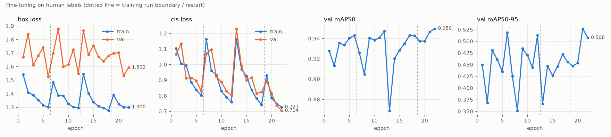

# 气孔检测模型 · 最终训练结果

> 本文件只汇总最终结论。完整过程（数据分析、各段训练、误差分析、显著性检验）见仓库根目录 [`docs/TRAINING_REPORT.md`](../../../docs/TRAINING_REPORT.md)。

## 1. 最终模型

| 项目 | 内容 |
|---|---|
| 权重文件 | [`models/stomata_yolov8n_p2_human_v2/best.pt`](../../../models/stomata_yolov8n_p2_human_v2/)（6.3 MB） |
| 结构 | YOLOv8n-P2：在 YOLOv8n 上增加 stride-4 的小目标检测头，2.9 M 参数 |
| 推荐置信度阈值 | **0.40** |
| 推理方式 | 原分辨率整图切成 640×640 小块（20% 重叠）逐块检测，再按"中心归属"去重合并（内置 `SlicedPredictor`；已与 SAHI 和多尺度 TTA 比较，见第 6 节） |

训练路线：COCO 预训练 → 外部自动计数流程的伪标签预训练（`model_review_samples/` 的 20 张图）→ `Stomata_Enhanced` 人工标注微调。

## 2. 训练数据

| 集合 | 图像 | 标注框 | 说明 |
|---|---|---|---|
| 训练 | 232 张（2560×1920） | 74,385 | `Stomata_Enhanced/train`，切成 2,784 个 640 切片 |
| 验证 | 59 张 | 17,490 | `Stomata_Enhanced/val` |

从训练中剔除的 2 张（标注不完整）：

- `108.1_1`：图中有数百个气孔，标签只有 3 个框；
- `349.3`：右侧整片未标注。

## 3. 最终结果

评估方式：整图推理，按气孔中心与人工框中心一对一匹配，容差为框长边的 0.5 倍（约 25 px）。
验证集 57 张：去掉了 `118.2`（曾用于伪标签模型训练）和 `221.2`（只标注了约 2/3）。

| 模型 | 阈值 | 精确率 | 召回率 | F1 | 每图计数平均误差 | 每图计数平均偏差 |
|---|---|---|---|---|---|---|
| 伪标签模型（起点） | 0.25 | 0.921 | 0.900 | 0.911 | 25.3 个（8.9%） | −6.9 |
| v1：人工标注 126 张 | 0.45 | 0.935 | 0.944 | 0.939 | 19.0 个（6.8%） | +3.1 |
| **v2：人工标注 232 张（最终）** | **0.40** | **0.937** | **0.945** | **0.941** | **18.5 个（6.6%）** | **+2.7** |

- v2 相比 v1：逐图 F1 在 39/57 张上更好（Wilcoxon p = 0.011）；计数误差略降，但不显著（p = 0.20）。
- **独立测试**：新补充的 106 张训练图在 v1 训练时从未出现过，可作独立测试集。用事先固定的阈值 0.45，v1 在这 106 张上的结果为：精确率 0.934、召回率 0.944、F1 0.939、计数误差 7.3%，与其验证集结果基本一致。这说明验证集上的数字没有明显偏乐观，新补标注的口径也与原有标注一致。
- v2 已用这 106 张训练，目前**没有**独立测试集；表中 v2 的数字是在验证集上选阈值得到的，可能略偏乐观。

## 4. 收敛情况



每段训练重新开启 mosaic 增强时指标先下降，随后回到同一水平（验证 mAP50 约 0.94–0.95）；训练损失仍在缓慢下降，验证指标已持平。数据量翻倍（128 → 232 张）只带来约 0.2 个百分点的 F1 提升。

**结论：在当前模型规模（YOLOv8n-P2）和 640 输入下已经收敛，上限约为 F1 0.94、计数误差 6–7%。**

## 5. 误差主要来源

| 类型 | 召回率 | 说明 |
|---|---|---|
| 小气孔（框长边 < 40 px） | 约 0.70 | 共约 240 个，占比很小但最难 |
| 密集簇（100 px 内 ≥ 5 个邻居） | 约 0.86 | ≥ 7 个邻居时降到约 0.2（样本仅 32 个） |
| 失焦 / 低对比度视野 | 整片漏检 | 误差最大的图：`292.1`、`23.2_1`、`16.1`、`43.3` |
| 低置信度预测（0.4–0.6） | — | 误检集中在这一区间；置信度 ≥ 0.7 的预测精确率约 0.98 |

误检样例中，相当一部分看上去是人工漏标的真实气孔，所以按现有标注算出的精确率偏保守。漏检和误检样例拼图：[漏检](../../../docs/images/fn_gallery_human.jpg)、[误检](../../../docs/images/fp_gallery_human.jpg)。

## 6. 训练后的诊断与改进尝试

在 v2 基础上，又做了以下诊断和改进尝试。所有比较都用同样的 57 张验证图和同样的评估口径，判断依据是逐图配对检验或按图 bootstrap 置信区间。**这些尝试都没有超过 v2，推荐模型和推理方式保持不变。**

| 尝试 | 是否需要训练 | 结果 | 结论 | 详情 |
|---|---|---|---|---|
| 尺寸 × 清晰度分层诊断（三轴解耦） | 否 | 同一尺寸档内，低清晰度一半的召回低 4–7 个百分点（40–70 px：0.933 对 0.969；≥ 70 px：0.878 对 0.945；p < 1e-4）。同时控制尺寸、对比度、密度和边缘、并只比较同一张图内的气孔后，清晰度和对比度仍各自独立影响召回 | 失焦确实是独立因素，但影响幅度有限，主要集中在最模糊的 1/4 | [`docs/error_stratify_v2_threeaxis.md`](../../../docs/error_stratify_v2_threeaxis.md)、[`docs/error_stratify_v2.md`](../../../docs/error_stratify_v2.md) |
| 离焦模糊 + 降对比度增强 | 是（4 段 CPU 训练，含对照） | 与同等条件、不加增强的对照相比，最模糊 1/4 的召回提高 1.2–1.4 个百分点（95% CI 不含 0）。但与 v2 相比，精确率低约 1 个百分点，F1 0.937 对 0.941，计数误差 7.5% 对 6.6%（42/57 张更差，p ≈ 3e-5）。新增误检多为模糊纹理 | 不采用；权重存档在 `models/stomata_yolov8n_p2_human_v3_defocus/` | [`docs/DEFOCUS_AUGMENT.md`](../../../docs/DEFOCUS_AUGMENT.md) |
| SAHI 对比内置 SlicedPredictor | 否 | SAHI（GREEDYNMM + IOS）的 F1 为 0.9405，内置切片器为 0.9410（逐图 p = 0.18），每图慢约 10%。SAHI 的 NMS + IOU 方式 F1 只有 0.92 | 未达到"F1 提升 > 0.5 个百分点"的门槛，继续用内置切片器，并改为默认后端 | [`docs/SAHI_COMPARISON.md`](../../../docs/SAHI_COMPARISON.md) |
| 多尺度 TTA（1.0× + 1.25× / 1.5×） | 否 | <40 px 气孔的召回提高 2.5–3.3 个百分点，但所有融合方式的 F1 都 ≤ 0.9409，每图耗时约为原来的 2.5 倍 | 不采用；`stomata/dl/tta.py` 保留为可选工具 | [`docs/TTA_COMPARISON.md`](../../../docs/TTA_COMPARISON.md) |
| "二合一"拆分（两个气孔被识别成一个框） | 否（先做诊断） | 937 个漏检中只有 9 个（1.0%）属于二合一，且这些框并不比正常框大（中位 1.1 倍）。即使把所有紧挨型漏检（91 个）全部找回，F1 也只能升到约 0.944 | 不做 | `scripts/fn_causes.py` |

**漏检原因分布**（v2，阈值 0.40，共 937 个漏检，`scripts/fn_causes.py`）：

| 原因 | 数量 | 占比 |
|---|---|---|
| 位置上有候选框，但分数低于 0.40 | 681 | 73% |
| 附近完全没有候选（多为失焦或低对比度） | 165 | 18% |
| 紧挨一个已匹配的框（粘连或合并的上限） | 91 | 10% |
| 其中：真正的二合一 | 9 | 1% |

**这几次尝试共同说明的问题：**

1. **主要瓶颈是模型打分，不是后处理。**近 3/4 的漏检其实已经被模型找到，只是分数偏低。无论换切片合并方式（SAHI）、多尺度融合，还是用增强改变模型对模糊目标的判断标准，召回的提高都伴随着等量的误检。在现有标注下，召回和精确率之间的取舍没有被改善。
2. **小气孔对整体 F1 的影响有限。**<40 px 的气孔只占 1.4%（240 个，漏检 71 个）。即使全部找回而且不增加误检，F1 也最多提高 0.22 个百分点。
3. **v2 的数字略偏乐观。**对照实验显示，即使不加增强，从 v2 继续训练也会回落到 F1 0.936。v2 是在同一验证集上挑出的检查点，其 0.941 包含选择偏差。所以各方案之间的差异只适合做相对比较。

## 7. 下一步建议

按预期收益排序：

1. **建立独立测试集**：例如 10 张从未参与训练和调参的整图，用来消除选择偏差，并公平比较 v2 和各个候选方案。
2. **复核标注**：
   - 补全 `108.1_1`、`349.3`（训练集）和 `221.2`（验证集）；
   - 复核误检集中的区域，尤其是模糊区域。抽查显示有约 1/4 到 1/3 的误检像是人工漏标，如果确实如此，精确率被低估了，各方案的取舍也需要重新评估。
3. **更大的模型或更高输入分辨率**（需要 GPU）：在不牺牲精确率的前提下提升打分能力，是目前唯一还没试过、且针对主要瓶颈的方向。当前 CPU 环境每轮约 17 分钟，不适合更大的模型。
4. **不建议**在 CPU 预算下继续调增强、多尺度 TTA 或拆分后处理：上面的实验显示这些方向的收益上限很低。

## 8. 使用

```bash
python scripts/dl_pipeline.py predict <图像目录> \
    --weights models/stomata_yolov8n_p2_human_v2/best.pt --conf 0.4 -o outputs_dl
```

默认使用内置 `SlicedPredictor`；加 `--sahi` 可改用官方 SAHI。输出每张图的检测叠加图和 `stomata_dl.csv`（每个气孔的坐标、长轴、置信度）。
